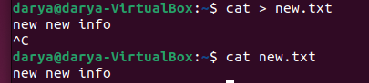
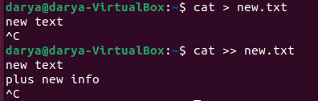
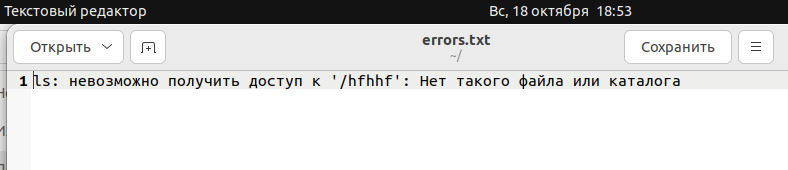
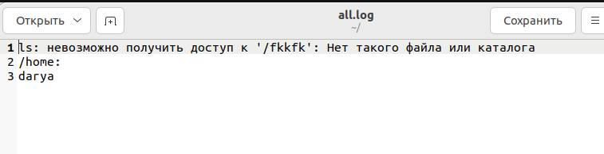
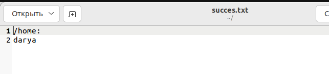
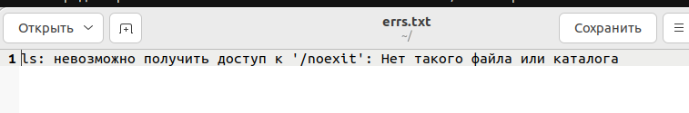
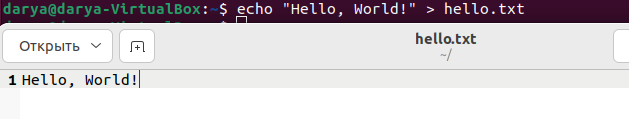
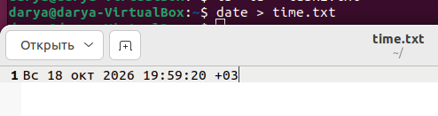
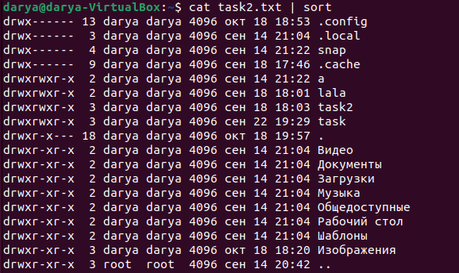
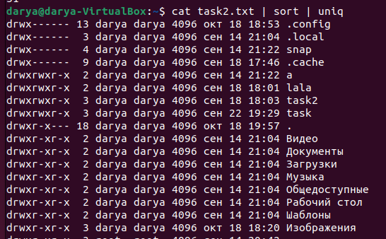

### Task 2.1

1) ### Как работают команды >,>>?

    Операторы перенаправления вывода в командной строке:
    ">": Записывает вывод команды в файл, если файл существует, он будет перезаписан, если файла нет, он будет создан, пример:
    Пример команды >
    

    ">>" : Добавляет вывод команды в конец файла, если файл существует, вывод допишется в конец, если файла нет, он будет создан, пример:
    Пример команды >>
    

2) ### Что такое стандартные потоки `stdin`, `stdout`, `stderr`?

    Стандартные потоки — это три предопределённых канала ввода-вывода, которые автоматически создаются для каждой программы при запуске и идентифицируются числовыми файловыми дескрипторами.
    Дескриптор 0 (stdin) отвечает за стандартный ввод данных в программу и по умолчанию связан с клавиатурой. 
    Дескриптор 1 (stdout) предназначен для вывода основных результатов работы и по умолчанию направлен на экран терминала.
    Дескриптор 2 (stderr) используется исключительно для сообщений об ошибках и предупреждениях, также по умолчанию выводящихся на экран.

3) ### Вывести содержимое файла, не используя текстовые редакторы

    При помощи команды cat выведем содержимое файла.
    

4) ### Создать файл с содержимым, не используя текстовый редактор.
    При помощи команды cat создадим файл с содержимым.
    

5) ### На примере подходящих команд:
    #### 5.1) перенаправить только `stdout` в файл;  
    
    Успешный вывод команды сохраняется в файл, а сообщения об ошибках остаются на экране терминала. Используется оператор > без указания дескриптора.

    #### 5.2) Перенаправление только stderr в файл
    
    
    Сообщения об ошибках записываются в файл, а нормальный вывод команды отображается на экране. Используется оператор 2> с явным указанием дескриптора ошибок.

    #### 5.3) Перенаправление stdout и stderr в один файл
    
    
    Оба потока (результаты и ошибки) объединяются и записываются в один файл. Используется конструкция > file 2>&1 или сокращённый вариант &> file

    #### 5.4) Перенаправление stdout и stderr в разные файлы
    
    
    
    Успешный вывод и сообщения об ошибках разделяются и сохраняются в два разных файла. Позволяет независимо анализировать результаты и проблемы.

6) ### Чем отличаются `stdout` и `stderr`?
    stdout (дескриптор 1):
    Предназначен для нормальных результатов работы программы. Данные, списки файлов, ответы на запросы

    stderr (дескриптор 2):
    Предназначен для диагностических сообщений и ошибок. Предупреждения, ошибки доступа, сбои

7) ### Что такое `stdin`? Покажите пример передачи данных команде через стандартный ввод.

    stdin (дескриптор 0) — поток, из которого команда читает входные данные. По умолчанию это клавиатура, но его можно перенаправить.
    Примеры:
    
    Команда echo выводит текст на экран (в stdout). Оператор > перехватывает этот вывод и сохраняет его в файл hello.txt.
    
    Команда ls -la формирует подробный список файлов и папок. Я перенаправляю весь этот вывод в файл task2.txt.
    
    Если файл time.txt уже существовал и содержал старый текст, эта команда полностью удалит старое содержимое и запишет туда только текущую дату и время.

8) ### Как отправить весь ненужный вывод команды в `/dev/null`?
    /dev/null — это специальное устройство, которое работает как «черная дыра»: всё, что туда попадает, мгновенно и безвозвратно исчезает.
    Чтобы отправить весь вывод команды (и успешный результат, и ошибки), нужно перенаправить оба стандартных потока.
    
    Всё ушло в /dev/null.

9) ### Чем отличается конвейер `|` от перенаправления `>`?
    ">" (перенаправление) — отправляет результат в файл на диске. Используется, когда нужно сохранить данные, чтобы прочитать или использовать их позже.
    
    | (конвейер / pipe) — отправляет результат следующей команде для мгновенной обработки. Используется, когда нужно сразу обработать результат с помощью другой команды. Файл не создается, всё происходит в оперативной памяти.
    
    cat читает файл, а sort выстраивает строки по порядку

10) ### Соберите команду из двух или трёх программ через `|`, чтобы результат одной команды обрабатывался следующей.

ls выводит список всех файлов, а wc -l получает этот список через | и считает количество строк.

сортирую список и убираю дубликаты