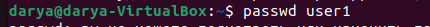
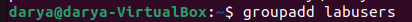
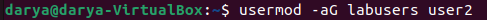
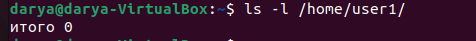
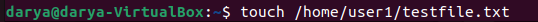
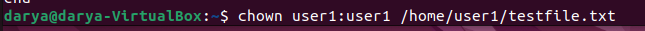
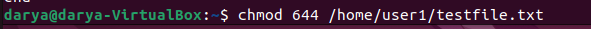
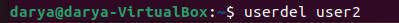
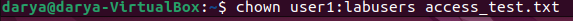
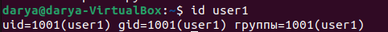

# Управление пользователями

 ## 1) Добавьте пользователей `user1` и `user2`:
   1.1) `user1` — оболочка bash;
   1.2) `user2` — оболочка sh;
   1.3) установите им пароли.

Для создания пользователей user1 и user2 с разными командными оболочками используются следующие команды:
    
    

Параметр -m создаёт домашний каталог пользователя, а -s задаёт командную оболочку.

Установка паролей:
    
    

## 2) Создайте отдельную группу `labusers`.
   2.1) Добавьте `user1` в группу администраторов системы.
   2.2) Добавьте `user1` и `user2` в группу `labusers`.
Создание группы labusers:
   
    
Добавление user1 в административную группу:
   
Добавление пользователей в группу labusers:
   

Параметр -aG добавляет пользователя в дополнительные группы, сохраняя его членство в остальных группах.

## 3) Что такое права доступа? Выведите права доступа на файлы в домашней директории одного из пользователей.

Права доступа - механизм, который определяет, какие действия (чтение, запись, выполнение) разрешены пользователям с файлами и папками в системе. Эти права назначаются трем категориям пользователей: владельцу, группе и всем остальным (others). Вывод прав на файлы в домашней директории user1(т.к. user1 - новый пользователь, в итоге выведет: "Итого 0"):


## 4) Создайте файл, доступный на чтение всем пользователям, а на запись только владельцу.
   4.1) Временно выставьте права `777`.
   4.2) Объясните, почему такая настройка обычно избыточна.
   4.3) Верните минимально необходимые права.
    Создаём файл:
   
    С помощью chown меняю владельца (change owner)файла, чтобы файл принадлежал пользователю user1:
   
    Изменяю права доступа (change mode): 
    6 (владелец) = rw-
    4 (группа) = r--
    4 (остальные) = r--
   
#### 4.1) Временно выставляю права 777
    7 (владелец) = rwx
    7 (группа) = rwx
    7 (остальные) = rwx
   
#### 4.2) 
Права 777 дают абсолютно всем пользователям системы возможность читать файл — просматривать его содержимое; писать — изменять содержимое, подменять данные, внедрять вредоносный код; выполнять — запускать файл как программу.

Это нарушает принцип минимальных привилегий: каждый пользователь должен иметь только те права, которые необходимы для выполнения его задач. Для обычного текстового файла достаточно прав 644 — владелец может читать и писать, остальные — только читать. Права 777 создают серьёзную угрозу безопасности.
#### 4.3)


## 5) Как называется встроенная учётная запись администратора в Linux?
В Linux встроенная учётная запись администратора называется root
   
## 6) Как выполнить одну команду с административными правами?

1. sudo /команда/ Выполнить команду от имени администратора.
2. su - для выполнения одной команды от имени root применяется утилита su с флагом -c

## 7) Есть ли у суперпользователя абсолютная возможность выполнить любую операцию? Приведите пример ограничения, существующего не из-за обычных файловых прав.
Суперпользователь root обладает широкими полномочиями, однако некоторые ограничения связаны с устройством системы, оборудованием и дополнительными механизмами безопасности.
Пример: Монтирование только для чтения: Если файловая система смонтирована в режиме ro (read-only), root не сможет записать данные, пока не перемонтирует раздел.

## 8) Удалите пользователя `user2`, сохранив его домашний каталог. Затем покажите, что пользователь действительно удалён.
Для удаления пользователя user2 без удаления его домашнего каталога используется команда: 

Параметр -r не указывается, поэтому домашний каталог не должен удаляться этой командой.
Проверка сохранности домашнего каталога:


## 9) Как изменить владельца и группу файла или каталога? Измените владельца созданного в пункте 4 файла.

Для изменения владельца папки используется команда chown (change owner). Команда chown, владелец - user1, группа - labusers, файл - access_test.txt:



## 10) Покажите UID, основной GID и дополнительные группы `user1`.
Для получения информации об учётной записи используется команда id:

Вывод:
```shall
uid=1001(user1) gid=1001(user1) groups=1001(user1)
```
uid=1001(user1) — идентификатор пользователя.

gid=1001(user1) — идентификатор основной группы.

groups=... — список всех групп, в которых состоит пользователь: собственная группа user1, группа администраторов sudo и группа labusers.